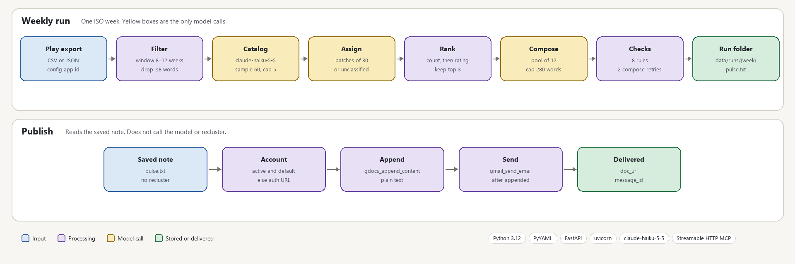

# Groww Weekly Review Pulse

https://groww-ai-agent.vercel.app

This pipeline turns a public Google Play export of Groww reviews into a checked weekly note, appends that note to an existing Google Doc, and sends it by Gmail.

## Business value

Product, Support, and Leadership need a weekly note they can read in minutes: the themes people mention, what those users wrote, and three next steps. The reviews are already public on the Play listing for `com.nextbillion.groww`, and the operator already has the export at `data/raw/play-groww.csv`. The clean file the implementation plan describes for week `2026-W41` still has 1,423 reviews, dates from 2026-08-03 through 2026-10-08, and a mean rating of 2.91. Keyword hits in that file overlap — orders and trading about 308, charts and speed about 214, customer support about 168 — so the export itself is not the note. The operator runs the week. Stakeholders read the Google Doc. Gmail goes to the address in `email_to` or `PULSE_EMAIL_TO`.

A summary written straight from the whole file can paraphrase a sentence, mention a theme that was never frozen, or add a metric the reviews do not contain. This pipeline asks the model for a catalog from a sample of 60 reviews, then for a note from at most 12 reviews in each of the top three themes. `checks.py` accepts the rendered note only when it has exactly three quotes, each a contiguous span of its cited review, exactly three actions that name a highlighted theme, and at most 280 words. The operator sees that as manifest status `ready`, or as `failed` with the broken rule in `check_results`, before `publish` appends or sends anything.

## What it does

The operator names an ISO week, such as `2026-W41`. `python -m groww_pulse run --week 2026-W41` reads `config.yaml` and the Play export, writes `data/runs/2026-W41/`, and stops. That command does not call the Docs or Gmail server. On the page, **Run this week** calls the same run and then calls publish only when the status is `ready`. **Publish saved note** calls publish alone.

Each model call is a single user message. A retry is a new call whose prompt includes the rejection. There is no stored conversation. `publish` reads the saved `pulse.txt` and leaves the export and the theme labels alone. Running the same week again deletes that folder and writes it from the current export. Publishing the same `pulse.txt` again reuses both idempotency keys, so the document is left as it is and mail is not sent again. A changed note gets new keys, appends another copy, and sends again.

The run and publish commands record different outcomes. They are not one error state.

- **`no_reviews`.** The window has nothing to cluster, and the model client is never built. In `test_empty_export_stops_before_the_model`, the only row is dated 2026-01-15. The manifest has `rows_kept: 0`, `reason` names the export, and `catalog.json` is absent.
- **`short_catalog`.** Fewer than three themes have a review, so compose never runs. In `test_short_catalog_stops_before_compose`, five reviews are `unclassified`, only `orders` has reviews, and `pulse.json` is absent.
- **`unclassified`.** A single review can abstain. The label is stored on the review, left out of ranking, and kept out of the note. In `test_four_theme_catalog_ranks_with_rating_tie_break`, "nice app and easy to use overall" and "best app for beginners really" stay `unclassified`. Orders and trading (two reviews, average rating 1) ranks above Charts and speed (two reviews, average rating 5). `test_theme_match_rejects_quotes_outside_the_top_three` rejects a quote whose review is `unclassified`.
- **`failed`.** The note was rejected, or a model call raised. `test_verbatim_rejects_a_one_word_change` rejects the quote "KYC verification asked for the same papers three times" because the stored review says "documents". `test_bad_quote_is_not_ready` sends the compose task three times, then writes status `failed` with an empty `doc_url`. If the Messages API returns `stop_reason` `refusal`, `model.py` raises `ModelError` and `run_week` records the same `failed` status.
- **`publish_failed`.** The local note is kept and a write did not finish. In `test_unauthorized_account_does_not_append`, `authorized` is false, so the publisher calls `google_begin_authorization` with `docs.append` and `gmail.send`, stores `authorization_url`, and does not append. The operator opens that URL and runs publish again. `test_append_failure_does_not_send` stops on `ACCESS_DENIED` and never calls `gmail_send_email`. `test_send_failure_keeps_doc_url` keeps `doc_url` and leaves `message_id` empty. `test_missing_document_id_makes_no_tool_calls` stops with reason "document id is missing" and an empty tool list. `test_failed_run_is_not_published` stops a `failed` run before any tool call.
- **`published`.** Append returns `status: appended`, then send returns `status: sent` and a `message_id`.

Rows removed by the privacy filter are a count, `rows_dropped`, on a run that can still finish. `test_privacy_drops_reviews_of_eight_words_or_fewer` drops the body "one two three four five six seven eight" and keeps the nine-word review.

## Tech stack

| Piece | What this repo uses |
| --- | --- |
| Language | Python `>=3.11`. `.python-version` is `3.12`. Package `groww-pulse` `0.0.1`. |
| Config | `config.yaml` via PyYAML `>=6`. `load_env_file` in `config.py` reads `.env` and leaves variables that are already set. |
| Model | `claude-haiku-5-5` (`DEFAULT_MODEL` in `model.py`). `POST https://api.anthropic.com/v1/messages`, header `anthropic-version: 2023-06-01`, `max_tokens` 4096, `thinking.type` `disabled`, `output_config.effort` `low`. `PULSE_MODEL`, `PULSE_API_KEY`, and `PULSE_MODEL_BASE_URL` override the model, the key, and the host. The key otherwise is `ANTHROPIC_API_KEY`. |
| Model transport | `urllib.request`. Timeout 120 seconds. Up to 8 attempts on HTTP 429 or 529, or on a URL error. A body containing `enforced_spend_limit_reached` stops immediately. |
| Web | FastAPI `>=0.115` and uvicorn `>=0.32`. One static page, `src/groww_pulse/web/static/index.html`, with no Node build. The page polls `GET /api/weeks/{week}/job` every 800ms. `/api/*` sends `Cache-Control: no-store`. |
| Tests | pytest `>=8` and httpx `>=0.27`. Tests pass a fake model client and a fake MCP client. |
| Docs and Gmail | google-workspace-mcp 0.2.0, Streamable HTTP, protocol `2025-03-26`. Default URL `https://mcp-server-production-af95.up.railway.app/mcp`. `PULSE_MCP_URL` and `PULSE_MCP_TOKEN` override the URL and the bearer token. |
| Hosts | The page is `https://groww-ai-agent.vercel.app` (Vercel project `groww-ai-agent`). The API is Railway service `web` at `web-production-f22c6.up.railway.app`. The volume `web-volume` is mounted at `/app/data`. |
| Storage | JSON and text files under `data/runs/{week}/`. No database and no queue. |

## Key architectural decisions



The top row is one `run` for an ISO week: code filters the export, the model proposes a catalog and labels each review, and code ranks, checks, and writes the folder. The bottom row is `publish` on that saved `pulse.txt`. It reads the note and calls the hosted MCP tools. Yellow is a Messages API call. Green is the run folder, or the Doc URL and `message_id` after a send.

### The export is filtered in code before any model call

`load_reviews` in `src/groww_pulse/ingest/file_export.py` maps the file, then calls `normalize_rows` and `apply_privacy`. `read_rows` copies rating, text, date, title, and app id. Reviewer name, profile link, user id, and device id are not fields on `Review`. `run_week` in `pipeline.py` writes `reviews.jsonl` first. When `rows_kept` is 0 it returns `no_reviews` before `LiveModelClient.from_env`.

`window_weeks` must be an integer from 8 to 12 (`WINDOW_WEEKS_MIN` and `WINDOW_WEEKS_MAX` in `config.py`). `config.yaml` sets 10. For `2026-W41` that is Monday 2026-08-03 through Sunday 2026-10-11 (`week_window` in `weeks.py`). A row is dropped when the body is empty, the rating is outside 1–5, or the date is outside that window. The id is the SHA-256 of app id, ISO date, and trimmed text. The first duplicate id wins. `store` is always `play`.

`MIN_REVIEW_WORDS` is 8: a redacted body of eight words or fewer is dropped. Emoji are stripped first. A body with two or more non-Latin letters, or two or more whole-word hits from the romanized Hindi list (`_HINDI_MARKER_HITS`), is dropped. Emails, phone numbers, UUIDs, hex strings of 16 or more characters, and `@handles` are replaced with `[redacted]`.

On the `2026-W41` file the implementation plan describes, 366 reviews are 9–12 words, so they clear this bar and are expected to fall through to `unclassified` at assignment. An eight-word review never reaches the catalog. That same file still has the name Ansh Agarwal in one body and the token `[redacted]` in two bodies. Those rows can be clustered. `quote_pool` in `compose.py` skips both, and a quote that copies either one fails the privacy check.

**Options set aside**

| Option | Why it was not chosen |
| --- | --- |
| App Store ingest | Deferred for this version in `docs/problemStatement.md`, `docs/architecture.md`, and the "Out of this plan" section of `docs/implementation-plan.md`. |
| A Play page fetcher or a store login | Listed as out of the plan. The architecture states that ingest reads export files and does not log into the Play Store or scrape store pages. |
| A hand-filtered copy in place of the raw export | The implementation plan says later stages read `data/runs/{week}/reviews.jsonl`, and that the raw export stays unchanged. |

### The catalog is frozen at five themes, then every review is labeled

`cluster.py` holds the caps: `MAX_THEMES` is 5, `PULSE_THEME_COUNT` is 3, `BATCH_SIZE` is 30, and `SAMPLE_TARGETS` is 24 reviews rated 1, 12 rated 2–3, and 24 rated 4–5. The sample is round-robin across ISO weeks. The same reviews produce the same sample.

`propose_catalog` allows one retry. A sixth theme, a bad id, a duplicate id, or an example phrase that is not a span of the sample is rejected. `test_six_theme_catalog_fails_after_one_retry` stops after that retry. `test_invented_example_phrase_still_fails` rejects a phrase that never appears. The catalog file is written before any assignment call. The assignment prompt receives that catalog and does not receive the seed list, which `test_four_theme_catalog_ranks_with_rating_tie_break` asserts. Reviews are sorted by id and sent 30 at a time. A missing id or a label outside the catalog is retried once for that review (`test_assignment_retries_a_bad_label_once_per_review`). The prompt tells the model that a review matching two themes takes the theme it spends more of its text on, so counts stay exclusive.

`rank_themes` orders by review count descending, then lower average rating, then a more recent median date (the upper median when the count is even), then theme id. The first three themes with at least one review become `top_theme_ids`. Themes four and five stay in `catalog.json`.

The seeds in `SEED_HINTS` are orders and trading; charts, speed, and stability; customer support; charges and brokerage; and payments, withdrawals, and mutual funds. The catalog prompt says to fold KYC, statements, IPO, and login into the closest of those five, and that undifferentiated praise is not a theme. The model may rename, merge, or drop a seed.

The cost shows up in the tie. In `test_four_theme_catalog_ranks_with_rating_tie_break`, Orders and trading and Charts and speed both have two reviews. Orders, at average rating 1, ranks first. Charts, at average rating 5, ranks second. Customer support and Charges each have one review at average rating 1. Customer support's review is dated 2026-10-01 and Charges' review is dated 2026-08-10, so the more recent median date keeps Customer support in the top three and leaves Charges in the catalog only. The implementation plan says that on the `2026-W41` file, support is both large and the lowest-rated cluster, so this rating order is what separates it from a similarly sized theme. A full week of 1,423 reviews is one catalog call and 48 assignment batches. A label outside the catalog fails that review after one retry.

**Options set aside**

| Option | Why it was not chosen |
| --- | --- |
| The brief's seed list: onboarding, KYC, payments, statements, withdrawals | The implementation plan says the theme language in the `2026-W41` file does not match that list. `cluster.py` sends `SEED_HINTS` and tells the model to fold KYC, statements, IPO, and login into the closest seed. |
| A new theme id invented during assignment | The architecture says assignment calls receive the frozen catalog and cannot add labels. A label outside the catalog is retried once, then `ClusterError` stops the run. |

### The composer sees 12 reviews from each highlighted theme

`quote_pool` in `compose.py` returns at most `POOL_LIMIT` (12) reviews for one theme. A body containing `[redacted]`, or a personal name from `personal_names`, is skipped. The name allowlist leaves product phrases such as "Angel One", "Google Pay", and "Mutual Fund" in place. A body of `PLAY_CAP` (490) characters or more is skipped when the theme still has a shorter review. Preferred rows have 15 to 80 words and end with `.`, `!`, or `?`. The pool is spread across star ratings.

The compose prompt asks for about `TARGET_WORDS` (250), at or under `max_words` (280 in `config.yaml`). Each summary is capped at `SUMMARY_WORD_CAP` (16) words in the prompt. Each action cap is `min(22, max(name_words + 6, 12))`. The prompt also reserves words for the title, the volume sentence, the quotes, and the attributions before it tells the model how many words summaries and actions may use. Quotes must be copied as a contiguous span. The prompt forbids finishing a sentence the Play cap cut off, and forbids a person's name.

`test_quote_pool_prefers_complete_sentences_and_caps_at_twelve` returns 12 reviews and leaves out a 500-character body, a body containing `[redacted]`, and a body that names Ansh Agarwal. `test_quote_pool_keeps_a_capped_review_when_it_is_the_only_one` keeps a 500-character body when the theme has nothing else, and the prompt still tells the model to leave a cut-off sentence unfinished. The implementation plan's file has 39 reviews at 490–500 characters that stop mid-sentence, and about 308 keyword hits for orders and trading. The compose prompt for a theme contains only the dozen the pool kept.

**Options set aside**

| Option | Why it was not chosen |
| --- | --- |
| Sending every review in a top theme | Phase 4 of the implementation plan says the composer sees a quote pool, and the phase exit requires that a theme prompt never include more than the 12-review pool. |

### Eight checks accept the note, and compose may retry twice

`check_pulse` in `checks.py` runs eight rules, in order: `theme_cap`, `quote_count`, `verbatim`, `theme_match`, `action_count`, `length`, `privacy`, `window`. The catalog must hold 1 to 5 themes, and the rendered note may name only the top three. Quotes and actions must number exactly `quote_count` and `action_count` (both 3). Each action's text must contain its theme name. A quote must be a non-empty span of the cited review after whitespace is collapsed. The cited review's `theme_id` must be one of `top_theme_ids`, and its date must fall inside the run window. Length is `len(note.split())` and must be at most `max_words` (280). Privacy rejects an email, phone, device id, or `@handle`, the token `[redacted]`, and a personal name inside a quote.

`COMPOSE_ATTEMPTS` is 3, so the first draft and two retries. The retry prompt includes the failing rule and the rejected note. When length failed and the quote rules did not, the prompt tells the model to keep the quote strings and shorten summaries and actions (`test_length_retry_keeps_the_quote_strings`). If the note still fails, `compose_directory` writes the last pulse for inspection and raises `ComposeError`. `run_week` then stores status `failed`. `publish_saved_run` makes no tool calls for that status.

A one-word paraphrase is enough to lose the note: "papers" in place of "documents" fails `verbatim`. A quote that copies "Ansh Agarwal" out of an otherwise verbatim span fails `privacy` in `test_privacy_rejects_a_personal_name_in_a_quote`. Naming a fourth theme, Statements, in the note fails `theme_cap` in `test_theme_cap_rejects_a_fourth_theme_in_the_note`.

### Publish appends the saved note, then sends it

`publish_saved_run` in `src/groww_pulse/publish/publisher.py` is the only code that calls MCP. The manifest status must be `ready`, `publish_failed`, or `published`. The document id is `PULSE_DOC_ID` or `doc_id`. The recipient is `PULSE_EMAIL_TO` or `email_to`. Either one missing stops the command before a tool call.

The tool order is `google_list_accounts`, then `google_authorization_status` with `capability: all` for the account whose `status` is `active` and `default` is true. When that account is missing or `authorized` is not true, the publisher calls `google_begin_authorization` with `docs.append` and `gmail.send`, stores `authorization_url`, sets `publish_failed`, and returns. The tool returns a URL and does not wait for the browser.

Append uses `gdocs_append_content` with `format: plain_text` and `prepend_newline: true`. The idempotency key is `pulse-{week}-doc-{hash}`, where `{hash}` is the first 12 hex characters of the SHA-256 of `pulse.txt`. Send uses `gmail_send_email` only after append reports `status: appended`. The subject is `Groww weekly pulse — {week}`, built in `publisher.py`. `doc_title_pattern` is loaded from config and is not sent. The mail body is the note plus `https://docs.google.com/document/d/{document_id}/edit`. The call omits `cc`, `bcc`, and `attachments`. The mail key is `pulse-{week}-mail-{hash}` of that body.

`_ATTEMPTS` is 3. A call is repeated only when `error.retryable` is true, which `test_retryable_append_is_retried_once` covers for `RATE_LIMITED`. `test_idempotency_conflict_is_not_retried` stops on `IDEMPOTENCY_CONFLICT`. A successful send stores `message_id`. The server includes the warning `DELIVERY_NOT_GUARANTEED`.

The same `pulse.txt` produces the same two keys, so a second publish of that file does not append or send again (`test_same_note_reuses_idempotency_keys`). A changed note uses new keys (`test_changed_note_uses_new_keys`). An append failure leaves Gmail uncalled, which matters because a later publish can still send, and a send failure leaves the Doc URL in place while `message_id` stays empty.

**Options set aside**

| Option | Why it was not chosen |
| --- | --- |
| Creating the Doc, replacing its body, or finding it by title | The architecture and Phase 6 say the server cannot find a document by title, create one, or replace its body. `document_id` comes from config or `PULSE_DOC_ID`. |
| A Gmail draft | The problem statement asked for a draft. Phase 6 says this server has no draft tool, so publish calls `gmail_send_email`. Attachments are omitted because the schema rejects them, which also keeps `reviews.jsonl` off the message. |
| A Google OAuth client or Google REST client in this repo | The problem statement requires MCP rather than a bespoke OAuth and REST client. Phase 6 repeats that the pipeline has neither. |

## How to run

Python 3.11 or newer is required. The checked-in version file is 3.12. The Play export is gitignored. Place it at the path in `config.yaml`, `data/raw/play-groww.csv`, before a live week. `config.yaml` must set `window_weeks` from 8 to 12, a non-empty `apps` list, `email_to`, and `doc_id` (a document id or a Docs URL) before publish can write.

From the repository root:

```text
python -m pip install -e ".[dev]"
```

That installs `groww_pulse` and the test dependencies from `pyproject.toml`. Railway installs `requirements.txt` instead and starts with `PYTHONPATH=src`, as in the `Procfile`.

Copy `.env.example` to `.env` and set the keys you need. The CLI loads that file from the directory that contains `config.yaml`. A variable already set in the environment is left unchanged.

| Variable | Required | What it sets |
| --- | --- | --- |
| `ANTHROPIC_API_KEY` | For a live `run` | Messages API key. `PULSE_API_KEY` is accepted as an alias. |
| `PULSE_MCP_TOKEN` | For a live `publish` against the hosted server | Bearer token. Sent only when set. |
| `PULSE_MODEL` | No | Model name. Default `claude-haiku-5-5`. |
| `PULSE_MODEL_BASE_URL` | No | API host. Default `https://api.anthropic.com`. |
| `PULSE_MCP_URL` | No | MCP endpoint. Default `https://mcp-server-production-af95.up.railway.app/mcp`. |
| `PULSE_DOC_ID` | No | Overrides `doc_id` in `config.yaml`. |
| `PULSE_EMAIL_TO` | No | Overrides `email_to` in `config.yaml`. |
| `PULSE_API_TOKEN` | On the public hosts | When set, `POST /api/weeks/{week}/run` and `POST /api/weeks/{week}/publish` require `Authorization: Bearer`. GET routes stay open. Leave it unset for local `serve`. |
| `PULSE_RAILWAY_HOST` | On Vercel | Railway hostname with no `https://`. `vercel.json` proxies `/api/*` there and adds the bearer token. |

Then, in this order:

```text
python -m pytest
```

Reads `tests/` and `tests/fixtures/play-sample.csv`. Writes only temporary directories. Makes no live model or MCP calls.

```text
python -m groww_pulse run --week 2026-W41
```

Reads `config.yaml`, `.env`, and `data/raw/play-groww.csv`. Replaces `data/runs/2026-W41/` with `reviews.jsonl`, `catalog.json`, `pulse.json`, `pulse.txt`, and `manifest.json`. Prints the status. Exit 0 means `ready`. A week string that is not `YYYY-Www` exits 2. An empty window prints `no_reviews` and exits 1.

```text
python -m groww_pulse publish --week 2026-W41
```

Reads that run folder, `config.yaml`, and `.env`. Calls the MCP server. Updates `doc_url`, `message_id`, `authorization_url`, and `status` in `manifest.json` and `pulse.json`. Does not read the Play export again. Exit 0 means `published`.

```text
python -m groww_pulse serve
```

Reads `config.yaml` and `data/runs/`. Serves the page at `http://127.0.0.1:8000`. `--host` defaults to `127.0.0.1` and `--port` defaults to 8000. **Run this week** starts one background job for that week and returns HTTP 202. A second start while the job is `running` is rejected. **Publish saved note** calls `publish_week` for a saved pulse whose status is `ready` or `publish_failed`.

The public process uses the `Procfile`:

```text
PYTHONPATH=src python -m groww_pulse serve --host 0.0.0.0 --port $PORT
```

Vercel serves `src/groww_pulse/web/static` and proxies `/api/*` to Railway. The deployment steps, volume uploads, and the production check are in `docs/deployment-plan.md`.

## Repository layout

```text
config.yaml                         # window, Play package, doc id, recipient, counts
.env.example                        # variable names for the model, MCP, and the page
pyproject.toml                      # package metadata and local dependencies
requirements.txt                    # packages Railway installs
Procfile                            # Railway start command
vercel.json                         # static page and /api rewrite
src/groww_pulse/__main__.py         # run, publish, and serve
src/groww_pulse/pipeline.py         # one week from ingest through checks; publish entry
src/groww_pulse/config.py           # config.yaml and .env
src/groww_pulse/weeks.py            # ISO week and the 8–12 week window
src/groww_pulse/models.py           # Review, Theme, Quote, Action, Pulse
src/groww_pulse/ingest/file_export.py  # CSV and JSON Play exports
src/groww_pulse/normalize.py        # dates, ratings, duplicate ids
src/groww_pulse/privacy.py          # redaction, word bar, English filter
src/groww_pulse/model.py            # Anthropic Messages client
src/groww_pulse/cluster.py          # sample, catalog, assignment, rank
src/groww_pulse/compose.py          # quote pool, note, retries
src/groww_pulse/checks.py           # the eight grounding rules
src/groww_pulse/publish/publisher.py   # account, append, send, idempotency keys
src/groww_pulse/publish/mcp.py      # Streamable HTTP client
src/groww_pulse/publish/docs.py     # gdocs_append_content arguments
src/groww_pulse/publish/gmail.py    # gmail_send_email arguments
src/groww_pulse/web/app.py          # page and JSON API
src/groww_pulse/web/jobs.py         # one background job per week
src/groww_pulse/web/static/index.html  # operator page
tests/                              # fake model and MCP clients; no live calls
data/raw/                           # operator export; gitignored
data/runs/                          # generated week folders; gitignored
docs/                               # brief, architecture, plan, deployment
```

## Where to read more

- [docs/problemStatement.md](docs/problemStatement.md) — the brief: who the note is for, the five-theme cap, the three quotes and three actions, and the MCP requirement.
- [docs/architecture.md](docs/architecture.md) — stage order, the pulse shape, the grounding rules, and the five MCP tools.
- [docs/implementation-plan.md](docs/implementation-plan.md) — the build phases and the measured shape of the `2026-W41` Play file.
- [docs/deployment-plan.md](docs/deployment-plan.md) — Vercel, Railway, the volume at `/app/data`, and the production check.
