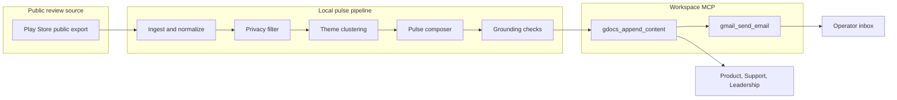
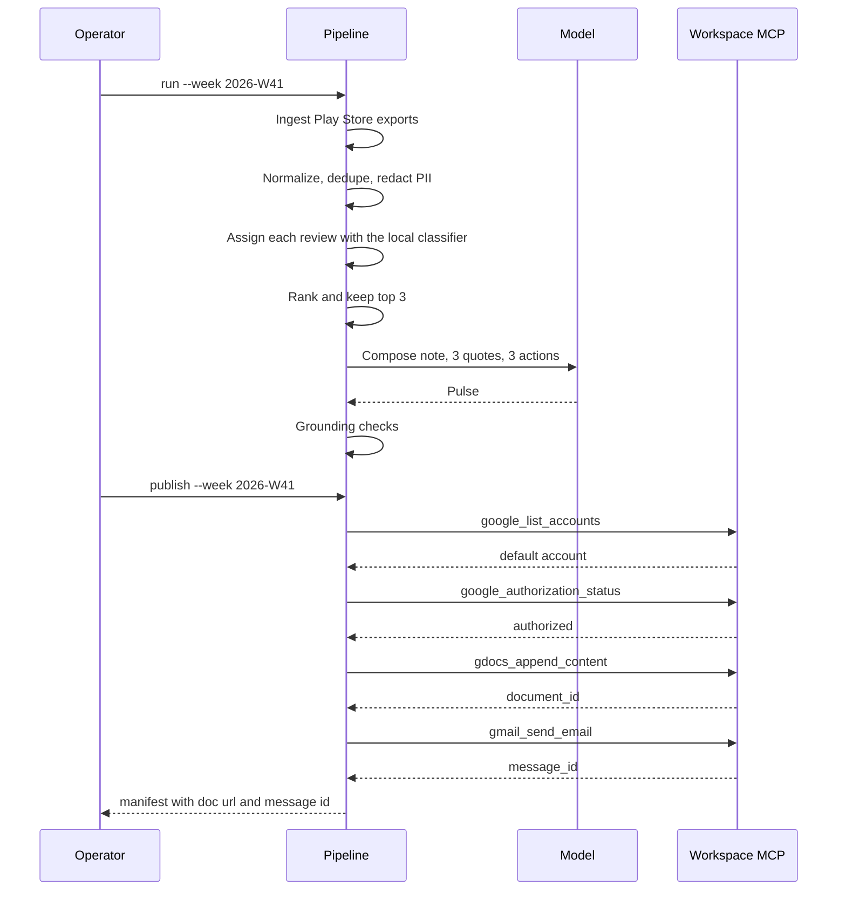

# Architecture — Groww Weekly Review Pulse

This document describes how the system turns public Groww Google Play reviews into a one-page weekly pulse, an appended Google Doc, and a sent Gmail message. It follows [problemStatement.md](problemStatement.md).

The App Store is deferred. This version ingests Play Store exports only.

## 1. Purpose

Groww (Stocks, Mutual Fund, IPO) receives public reviews on Google Play. Product, Support, and Leadership need a weekly note they can read in minutes: the themes people mention most, what users actually wrote, and three next steps grounded in those themes.

The system does four jobs:

1. Import public reviews from roughly the last 8–12 weeks.
2. Group them into at most five themes and highlight the top three.
3. Write a scannable pulse of about 250 words, with three verbatim quotes and three action ideas.
4. Append the pulse to an existing Google Doc and send it by Gmail to the operator or an alias.

Google Docs and Gmail are reached only through one hosted MCP server, [google-workspace-mcp](https://github.com/DeepakAg1234/MCP-Server). The pipeline does not implement an OAuth client or call Google REST APIs itself.

## 2. System context



The operator supplies review exports, creates the Google Doc once, and runs the weekly job. Stakeholders read that Doc. The pipeline appends the note to it and sends the same note by Gmail. It does not create the Doc, replace its body, or save a draft.

Primary Play listing used as the default app:

`com.nextbillion.groww` — https://play.google.com/store/apps/details?id=com.nextbillion.groww&hl=en_IN

Additional Groww Play packages (Stocks, Mutual Fund, IPO) are configuration, not hard-coded logic. Each configured package is ingested into the same review schema and tagged with its app id so a later pulse can say which app a theme came from.

## 3. Design principles

- **MCP at the edge.** Docs and Gmail stay behind a thin publisher. Swapping MCP servers does not change clustering or the pulse format.
- **Deterministic gates around the model.** Theme count, quote verbatim checks, word count, and PII stripping are code. A local classifier assigns themes. The model writes summaries, quotes, and actions. Code accepts or rejects the note.
- **Public Play exports only.** Ingest reads Google Play export files the operator places in the repo. The pipeline does not log into the Play Store and does not scrape store pages.
- **Anonymous by construction.** Reviewer names, profile URLs, and device identifiers are dropped at ingest and never enter the model prompt or the published note.
- **One run, one week, one note.** A run is keyed by ISO week and app set. Re-running that week refreshes the local artifact. Publishing the same `pulse.txt` again does not append or send a second time. A changed note appends another copy to the same document and sends again.
- **Traceable quotes.** Every published quote stores the local review id it came from. A quote that is not an exact span of that review is discarded.

## 4. Runtime shape

A single Python command runs the week. Stages are plain functions with typed inputs and outputs. There is no database or queue. Local JSON artifacts are the record of what was published. `python -m groww_pulse serve` hosts one page over those artifacts. The default bind is `127.0.0.1`. `--host 0.0.0.0` is for the Railway process.

```text
python -m groww_pulse run --week 2026-W41
```

Stages, in order:

| Stage | Responsibility | Failure behavior |
| --- | --- | --- |
| Ingest | Read configured Play Store exports | Stop if no reviews fall inside the window |
| Normalize | Map every source into one `Review` record | Drop rows with no text; record the drop count |
| Privacy | Remove identifiers; redact PII inside text | Drop a review if redaction leaves no usable text |
| Cluster | Assign each review to one of five fixed themes | Stop if that catalog is larger than `max_themes` |
| Rank | Order themes and choose the top three | Stop if fewer than three themes have at least one review |
| Compose | Draft the note, three quotes, three actions | Regenerate when a grounding check fails, up to two times |
| Publish | Append the note to the configured Doc, then send it | Write the local pulse first. If the append fails, do not send. |

The language model is used in Compose only. Cluster assigns themes with a local classifier. Ingest, privacy, ranking, grounding, and publish are deterministic.

## 5. Components

### 5.1 Ingest

The file export adapter reads CSV or JSON from `data/raw/` and returns raw rows tagged with the Play package they came from. Required columns, under any of the accepted header aliases:

| Canonical field | Accepted headers |
| --- | --- |
| rating | `rating`, `score`, `stars` |
| text | `text`, `content`, `review`, `body` |
| date | `date`, `created_at`, `at`, `updated` |
| title | `title`, `summary` (optional) |
| app_id | `app_id`, `package` (optional; defaults from config) |

Rows outside the configured window (default 10 weeks, allowed range 8–12) are ignored. The adapter records how many rows were read, kept, and dropped.

Every row is a Play Store review. There is no App Store feed and no Play HTML fetcher in this version.

### 5.2 Normalize

Each kept row becomes a `Review`:

| Field | Rule |
| --- | --- |
| `id` | Stable hash of app id, review date, and review text. Not derived from a reviewer. |
| `store` | Always `play` |
| `app_id` | Play package name |
| `rating` | Integer 1–5. Rows outside that range are dropped. |
| `title` | Trimmed string, possibly empty |
| `text` | Trimmed review body |
| `created_at` | ISO date |
| `theme_id` | Empty until clustering |

Duplicate ids collapse to one review. The first occurrence wins.

### 5.3 Privacy filter

Applied before any model call and again on the finished pulse.

Dropped and never stored:

- reviewer display name
- profile link
- user id
- device id
- locale-specific account identifiers

Redacted inside `title` and `text` before clustering:

- email addresses
- phone numbers
- strings that match a long device or advertising id
- `@handles`

Redaction replaces the span with `[redacted]`. A review whose body is empty after redaction is dropped. The published quote must still match the redacted text exactly, so the note never restores a redacted span.

### 5.4 Theme clustering

Clustering is closed-set classification into a fixed catalog of five themes. The catalog does not change from week to week, and the language model is not asked to invent or assign themes.

1. **Catalog.** The five themes are orders and trading; charts, speed, and stability; customer support; charges and brokerage; and payments, withdrawals, and mutual funds. Each theme has a stable id, a short name, a one-sentence definition, and two example phrases. Smaller topics in this file are folded into the closest of those five: IPO into orders, KYC and login into customer support, and statements into payments. Praise is recorded separately as General Appreciation. Keyboard mash is not a theme.
2. **Freeze.** That catalog is written to the run folder before any review is labeled. Labels cannot add a sixth theme.
3. **Assign.** A TF-IDF vectorizer and a logistic regression model, trained once on the labeled reviews in `theme_training.jsonl`, assign each review to exactly one theme id. On the 1,423-review week that file was built from, 1,365 reviews (about 96%) receive a label: charts, speed, and stability 321; General Appreciation 286; orders and trading 213; payments, withdrawals, and mutual funds 205; customer support 202; charges and brokerage 138. The other 58 stay `unclassified`. Praise that names no product issue is `general_appreciation`. A complaint or a nonsense body that matches no theme stays `unclassified`. Neither label counts as a sixth theme, and neither appears in the pulse. Count order puts charts, orders, and payments in the top three. Support has the lowest average rating (1.74) and stays fourth because it has fewer reviews than payments.
4. **Validate.** The classifier only returns a catalog id, `general_appreciation`, or `unclassified`. A configured `max_themes` below five stops the run before the catalog file is written.

Ranking inside the catalog:

- primary key: number of assigned reviews, descending
- tie-break: lower average rating first (sharper pain)
- second tie-break: more recent median review date

The pulse discusses the first three themes in that order. Themes four and five stay in the run manifest for audit and stay out of the note so the note remains scannable.

### 5.5 Pulse composer

Input is the top three themes, their counts, average ratings, and the redacted review texts that belong to them. Output is a `Pulse` object, then a rendered note.

The note contains, in this order:

1. A title with the week and the product name.
2. One sentence on volume: how many reviews were in the window, and the share sitting in the top three themes.
3. **Top themes.** For each of the three: name, review count, average rating, and one sentence on what users are asking for.
4. **User quotes.** Three verbatim snippets. Prefer one quote from each top theme. Each quote is a contiguous span of a single redacted review, short enough to read inline, with its star rating and Play package. No reviewer name.
5. **Action ideas.** Three concrete next steps, one anchored to each top theme. Each action names the theme and a product, support, or messaging move. Actions do not invent metrics, ship dates, or quotes.

Target length is about 250 words. A note over 280 words is sent back to the composer with an instruction to shorten the theme sentences and actions while keeping the three quotes intact.

### 5.6 Grounding checks

These run after Compose and before Publish. All of them must pass.

| Check | Pass condition |
| --- | --- |
| Theme cap | Catalog length is 1–5 and the note names only the top three |
| Quote count | Exactly three quotes |
| Verbatim | Each quote is a contiguous span of its cited review after whitespace normalization |
| Theme match | The cited review's `theme_id` is one of the top three |
| Action count | Exactly three actions, each referencing one top-theme name |
| Length | Word count of the rendered note is at most 280, aiming near 250 |
| Privacy | The rendered note matches none of the PII patterns, and contains no reviewer name field |
| Window | Every cited review date falls inside the run window |

A failed check returns the failing rule to the composer for one retry, then a second. After that the run stops and publish does not run. The failed pulse is saved under `data/runs/` so the failure can be inspected.

### 5.7 Publisher

The publisher is the only component that talks to MCP. It calls google-workspace-mcp 0.2.0 over Streamable HTTP at `https://mcp-server-production-af95.up.railway.app/mcp`. The process listens on port 8080; the client uses the HTTPS URL. `python -m groww_pulse publish --week YYYY-Www` reads the saved pulse and does not recluster.

The server exposes five tools. Publish uses them in this order:

| Tool | Input | Output used |
| --- | --- | --- |
| `google_list_accounts` | none | the account with `status: active` and `default: true` |
| `google_authorization_status` | `account_id`, `capability: all` | `authorized` |
| `google_begin_authorization` | `capabilities: ["docs.append", "gmail.send"]` | `authorization_url`, then stop |
| `gdocs_append_content` | `document_id`, `pulse.txt`, `format: plain_text`, `prepend_newline: true`, `account_id`, `idempotency_key` | `document_id`, `document_title`, `status: appended` |
| `gmail_send_email` | `to`, subject, body, `body_format: plain`, `account_id`, `idempotency_key` | `message_id`, `status: sent` |

`google_begin_authorization` runs only when the status check says the account is not authorized. It returns a URL and does not wait for the browser. The manifest records that URL and status `publish_failed`. No append or send follows.

The server cannot find a document by title, create one, or replace its body. Append inserts at the end and does not return the existing text. `document_id` comes from `doc_id` in config, or from `PULSE_DOC_ID`, and may be the raw id or a Docs URL. The body is `pulse.txt` as plain text. The publisher builds `doc_url` as `https://docs.google.com/document/d/{document_id}/edit`. `doc_title_pattern` is the email subject, not a document lookup.

The recipient is `PULSE_EMAIL_TO`, falling back to `email_to`. The subject is `Groww weekly pulse — {ISO week}`. The body is the note plus the Doc URL. The call omits `cc`, `bcc`, and `attachments`; the schema rejects attachments. There is no draft tool. A successful send includes the warning `DELIVERY_NOT_GUARANTEED`.

Each write uses an idempotency key, `pulse-{week}-doc-{hash}` or `pulse-{week}-mail-{hash}`, where `{hash}` is a short hash of the body. The same key and the same body return the stored result. A missing document id, or no active default account, stops with `publish_failed` before any write.

Every tool result is one envelope: `ok`, `operation_id`, `tool`, and either `result` plus `warnings` or `error`. The publisher reads `structuredContent`. It retries only when `error.retryable` is true.

The live client sends `PULSE_MCP_TOKEN` as a bearer when that variable is set. `PULSE_MCP_URL` overrides the hosted endpoint. The token, a Google refresh token, and a client secret are not written into the repo.

If the append fails, Gmail is not called. If the append succeeds and send fails, the manifest keeps `doc_url` and status `publish_failed`. A later `publish` retries from the saved pulse. The same `pulse.txt` does not append or send again. A changed note uses new keys, appends another copy, and sends again.

## 6. Data model

Artifacts for a run live in `data/runs/{iso-week}/`.

```text
data/runs/2026-W41/
  reviews.jsonl       # normalized, redacted reviews with theme ids
  catalog.json        # frozen theme catalog
  pulse.json          # structured pulse
  pulse.txt           # rendered note, the Doc body
  manifest.json       # counts, check results, doc url, message id
```

`pulse.json` shape:

```json
{
  "week": "2026-W41",
  "window": { "start": "2026-08-03", "end": "2026-10-11" },
  "review_count": 0,
  "themes": [
    {
      "id": "kyc",
      "name": "KYC",
      "definition": "Identity verification and document review.",
      "review_count": 0,
      "average_rating": 0,
      "summary": ""
    }
  ],
  "top_theme_ids": ["kyc", "payments", "withdrawals"],
  "quotes": [
    {
      "text": "",
      "rating": 2,
      "store": "play",
      "theme_id": "kyc",
      "review_id": ""
    }
  ],
  "actions": [
    { "theme_id": "kyc", "text": "" }
  ],
  "word_count": 0,
  "doc_url": "",
  "message_id": ""
}
```

`reviews.jsonl` is the source of truth for quotes. The note is a projection of `pulse.json`. Publishing never invents a fourth quote or a theme that is absent from `catalog.json`.

## 7. Configuration

`config.yaml` at the repo root:

```yaml
product_name: Groww
window_weeks: 10          # allowed: 8–12
apps:
  - store: play
    app_id: com.nextbillion.groww
    export: data/raw/play-groww.csv
email_to: ""              # operator or alias; required to send
doc_id: ""                # existing Google Doc id or URL; PULSE_DOC_ID overrides
doc_title_pattern: "Groww weekly pulse — {week}"  # email subject; not sent as a Doc title
max_themes: 5
pulse_theme_count: 3
quote_count: 3
action_count: 3
target_words: 250
max_words: 280
```

`email_to` may also be set with `PULSE_EMAIL_TO`, which overrides the file. `doc_id` may also be set with `PULSE_DOC_ID`. Compose calls Anthropic's Messages API at `https://api.anthropic.com/v1/messages` with model `claude-haiku-5-5`. The key is `ANTHROPIC_API_KEY`. `PULSE_MODEL`, `PULSE_API_KEY`, and `PULSE_MODEL_BASE_URL` override the model, the key, and the host. Clustering does not call that API.

## 8. Repository layout

```text
docs/
  problemStatement.md
  architecture.md
data/
  raw/                    # operator-supplied public exports; not committed
  runs/                   # generated artifacts; not committed
src/groww_pulse/
  __main__.py             # `run`, `publish`, and `serve`
  config.py
  models.py               # Review, Theme, Pulse
  model.py                # Anthropic Messages client
  classify.py             # fixed themes and the local classifier
  theme_training.jsonl    # labeled reviews the classifier is trained on
  weeks.py
  ingest/
    file_export.py
  normalize.py
  privacy.py
  cluster.py              # label with the classifier, then rank
  compose.py
  checks.py
  publish/
    mcp.py                # Streamable HTTP client
    publisher.py
    docs.py               # Docs MCP protocol
    gmail.py              # Gmail MCP protocol
  pipeline.py
  web/
    app.py                # page and JSON API
    jobs.py               # one background week job
    static/index.html
config.yaml
vercel.json               # static page and /api rewrite
```

`data/raw/` and `data/runs/` are gitignored. Exports can contain review text the team did not mean to commit, and run artifacts are regenerated.

## 9. End-to-end sequence



## 10. Privacy and compliance

- Store access is limited to public Google Play review exports.
- The pipeline has no store login, session cookie, or developer-console credential.
- Reviewer identity is not a field on `Review`.
- Classification reads the redacted review text locally and does not send it to a model. Compose prompts include that same redacted text only. They do not include file paths that might embed a username, and they do not include the operator's email.
- The Gmail message is addressed to the configured operator alias. It contains the pulse and the Doc link, not the raw review file.
- Logs record counts and ids. They do not record full review bodies.

## 11. Failure and recovery

| Situation | Result |
| --- | --- |
| No reviews in the window | Run stops before classification and before any model call. Manifest explains which Play exports were empty. |
| `max_themes` is below the fixed catalog | Run stops before `catalog.json` is written. |
| Fewer than three themes have reviews | Run stops before compose. Manifest lists the short catalog. |
| Quote fails the verbatim check | Composer retries with the rejected quote and the source review. Two failures stop publish. |
| Account missing or not authorized | Local `pulse.txt` is kept. Manifest status is `publish_failed` and includes `authorization_url` when the server returned one. No append or send runs. |
| Append fails | Local pulse is kept. Status is `publish_failed`. Gmail is not called. |
| Send fails after a successful append | `doc_url` is kept. Status is `publish_failed`. A later `publish` can retry. |
| Publish of the same `pulse.txt` | Both idempotency keys hit the stored results. The Doc is not appended again and mail is not sent again. |
| Publish of a changed note | New keys append another copy to the same document and send again. `run` still reclusters from the current export. |

## 12. Mapping to the brief

| Requirement | Where it is enforced |
| --- | --- |
| Last 8–12 weeks of reviews | `window_weeks` and the ingest date filter |
| Fields such as rating, title, text, date | `Review` model |
| At most five themes | Fixed catalog in `classify.py` and the `max_themes` cap |
| Pulse highlights the top three | Rank stage and grounding check |
| Three real user quotes, verbatim | Composer plus verbatim check against `reviews.jsonl` |
| Three action ideas grounded in the themes | Composer schema and theme-name check |
| About 250 words | `target_words` / `max_words` |
| Google Doc stakeholders can read | `gdocs_append_content` on the configured document |
| Gmail message to yourself or an alias | `gmail_send_email` after the append |
| MCP rather than hand-rolled Google OAuth | Publisher calls the hosted MCP server; no Google REST client in the repo |
| No PII in any artifact | Privacy filter before the model and again on the rendered note |

## 13. Build order

1. Models, config, file ingest, normalize, and privacy, with fixture exports.
2. Grounding checks against hand-written pulse fixtures, including a quote that is almost but not quite verbatim.
3. Cluster and compose behind the checks.
4. Docs and Gmail publish against `https://mcp-server-production-af95.up.railway.app/mcp`, after a local pulse file already exists.
5. One end-to-end run on a small public export for `com.nextbillion.groww`, then a full 8–12 week window.
