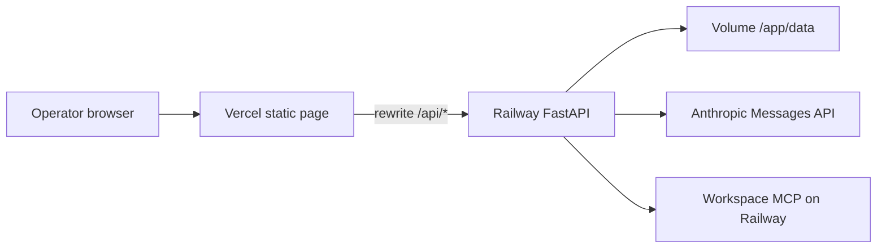

# Deployment Plan — Groww Weekly Review Pulse

Deploy the current app as two public services. Vercel serves the latest page, `src/groww_pulse/web/static/index.html`. Railway runs the FastAPI process that ingests Play exports, clusters, composes, and publishes. Docs and Gmail stay on the MCP server that is already hosted at `https://mcp-server-production-af95.up.railway.app/mcp`.

The page calls `/api/...` on its own origin. Vercel forwards those paths to Railway, so the HTML does not grow a second API client. Local `python -m groww_pulse serve` stays on `127.0.0.1` for development.



## What each host runs

| Piece | Host | Why |
| --- | --- | --- |
| `index.html` | Vercel | Static page, no Node build |
| FastAPI, pipeline, background week job | Railway | Python process that stays up while a week clusters |
| `data/raw/play-groww.csv` and `data/runs/` | Railway volume mounted at `/app/data` | Both trees are gitignored, and a Railway disk is replaced on every deploy |
| Anthropic key, MCP token, Doc id, recipient | Railway variables | The browser and Vercel never see them |
| Google Doc and Gmail | Existing MCP service | This repo still has no Google OAuth client |

A full week classifies every review locally, then calls the model once to compose the note, plus at most two retries. `POST /api/weeks/{week}/run` returns `202` and the work continues on a thread inside the Railway process. The page polls `GET /api/weeks/{week}/job`. That thread and its job table live in one process, so the Railway service stays at one replica.

## Code to land before the first deploy

The local server refuses a public bind, and the public URLs can start a paid model run and send mail. Land these in the repo, then deploy.

1. **Public bind for Railway only.** Extend `serve` with `--host`, default `127.0.0.1`. The Railway start command passes `--host 0.0.0.0` and `--port` from Railway's `PORT`. Leave the local default on localhost.
2. **A shared secret on writes.** Read `PULSE_API_TOKEN`. Require `Authorization: Bearer <token>` on `POST /api/weeks/{week}/run` and `POST /api/weeks/{week}/publish`. Leave the GET routes open so the page can list a week. Vercel adds the header on the rewrite, so the token is a Vercel env var and is absent from the HTML.
3. **No caching of API responses.** Send `Cache-Control: no-store` on `/api/*`. The page polls job state every 800ms. A cached `running` or `idle` snapshot would freeze the week view.
4. **Vercel config** in `vercel.json`. The page is `src/groww_pulse/web/static`. `/api/(.*)` is proxied to `https://$PULSE_RAILWAY_HOST/api/$1`, and the route sets `Authorization: Bearer $PULSE_API_TOKEN` from the Vercel environment. The destination keeps the `/api` prefix. `PULSE_RAILWAY_HOST` is the Railway hostname only, with no `https://`.

5. **Railway start.** Railpack installs the packages listed in `requirements.txt`. Python is 3.12 (`.python-version`). `PYTHONPATH=src` lets the process import `groww_pulse` from the source tree. The process starts with:

```text
PYTHONPATH=src python -m groww_pulse serve --host 0.0.0.0 --port $PORT
```

That command is the Procfile and the start command in `.railway/railway.ts`. The health check path is `/api/weeks`, the timeout is 120 seconds, and the service is one replica. The data volume mounts at `/app/data`. Do not deploy a new build while a week job is `running`.

## Railway

The running API is the Railway service `web` in project `agile-possibility`. Root directory is the repository root. Railpack is the builder. `.railway/railway.ts` still describes a service `api`, a project `groww-pulse`, and a volume `pulse-data`. That file was not applied. The attached volume is `web-volume`, mounted at `/app/data`. Keep one replica. Do not deploy a new build while a week job is `running`.

### Volume

`web-volume` is mounted at `/app/data`. Railway builds into `/app`, and the pipeline resolves `data/raw` and `data/runs` from the directory that contains `config.yaml`. The mount covers both trees. Volumes attach at container start, so a file copied in only during the image build is hidden once the volume is mounted. The export and the `2026-W41` folder are already on this volume. To replace them:

```text
railway volume files upload ./data/raw/play-groww.csv /raw/play-groww.csv
```

That remote path is inside the volume, which the process sees as `/app/data/raw/play-groww.csv`, matching `export: data/raw/play-groww.csv` in `config.yaml`.

Replace the saved week with:

```text
railway volume files upload ./data/runs/2026-W41 /runs/2026-W41
```

Confirm with `railway volume files list /raw` and `railway volume files list /runs`.

### Variables

Set these on the Railway service. `.railway/railway.ts` preserves the three required secrets if they are already set, and does not write their values. Do not commit them. On Vercel, set only `PULSE_API_TOKEN` and `PULSE_RAILWAY_HOST`.

| Variable | Required | Role |
| --- | --- | --- |
| `ANTHROPIC_API_KEY` | Yes | Compose. Clustering does not use it. `PULSE_API_KEY` is accepted as an alias |
| `PULSE_MCP_TOKEN` | Yes | Bearer token for the hosted Docs and Gmail MCP server |
| `PULSE_API_TOKEN` | Yes | Bearer token the page's host sends on Run and Publish |
| `PULSE_DOC_ID` | No | Overrides `doc_id` in `config.yaml` |
| `PULSE_EMAIL_TO` | No | Overrides `email_to` in `config.yaml` |
| `PULSE_MCP_URL` | No | Defaults to the MCP host above |
| `PULSE_MODEL` | No | Defaults to `claude-haiku-5-5` |

`config.yaml` already has the window, the Play package, the Doc, and the recipient. Railway env overrides win for the Doc and the recipient because `load_env_file` does not replace variables that already exist, and Railway injects its variables before the process starts.

The public hostname in use is `web-production-f22c6.up.railway.app`. That value, with no `https://`, is `PULSE_RAILWAY_HOST` on Vercel. A request to the Railway host still reaches the API; the write token is what stops an anonymous Run or Publish.

## Vercel

The Vercel project is `groww-ai-agent`, from the same repo. Framework preset is Other. Install command and build command are empty. Output directory is `src/groww_pulse/web/static`, also set in `vercel.json`.

Production env on Vercel is only:

| Variable | Role |
| --- | --- |
| `PULSE_API_TOKEN` | Same value as Railway. Injected on `/api/*` rewrites. Absent from the page |
| `PULSE_RAILWAY_HOST` | Railway hostname only, no scheme. `vercel.json` proxies `/api/*` there |

The operator page is `https://groww-ai-agent.vercel.app`. The Railway URL is the API, not the page operators use.

The Vercel project `groww-ai-agent` is linked to `DeepakAg1234/Groww-AI-Agent` on `main`. A push rebuilds the page. The Railway service is a separate project from the same repo. `.gitignore` excludes `data/raw/*`, `data/runs/*`, `.env`, and `.vercel`. The volume, not the git push, holds the export and the week folders.

## First production check

Do these in order. Stop if a step fails.

1. `GET https://groww-ai-agent.vercel.app/` returns the pulse page.
2. `GET https://groww-ai-agent.vercel.app/api/weeks` returns JSON. With the `2026-W41` folder on the volume, that week is listed as `published`.
3. Open the Vercel URL, leave the week as `2026-W41`, and confirm the page shows 1,423 kept reviews, the catalog, three quotes, three actions, the note, `doc_url`, and `message_id`.
4. `POST https://web-production-f22c6.up.railway.app/api/weeks/2026-W41/run` with no `Authorization` header returns `401`.
5. On the page, **Publish saved note** for a week already `published` is rejected by the API with the existing "not ready" response. It does not call the model.
6. Run a week that has no rows in the export window, or a fixture week, and confirm the job reaches `no_reviews` or `ready` and the Railway log shows the Anthropic and MCP calls only when a real week is composing or publishing.
7. For a real publish, read the Google Doc and the sent message. The appended text matches `pulse.txt`. Publishing that same file again does not append or send a second copy.

## While it is up

- One Railway replica. A second instance has its own job table and can start a second run of the same week.
- A deploy restarts the process and drops an in-memory job. Wait until the week status is `published`, `no_reviews`, `short_catalog`, `failed`, or `publish_failed` before shipping.
- The Play export is only on the volume. Replacing `play-groww.csv` is another `railway volume files upload` of `/raw/play-groww.csv`. A new git deploy does not refresh it.
- If **Publish saved note** times out in the browser, reload the week before clicking it again. A finished append stores `doc_url` and a send stores `message_id`. The same `pulse.txt` reuses its idempotency keys, so a repeat does not append or send a second time.
- Secrets stay in the Railway variable editor. `.env` stays gitignored. The page bundle contains no API key and no MCP token.
