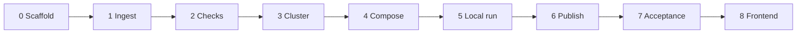

# Implementation Plan — Groww Weekly Review Pulse

Phase-wise plan for building the pipeline in [architecture.md](architecture.md). Each phase ends with something that runs and a check that must pass before the next phase starts.

This version ingests **Google Play exports only**. The App Store stays deferred. Docs and Gmail are reached through the hosted MCP server in Phase 6. The pipeline does not scrape the Play Store and does not implement Google OAuth.

## How to use this plan

Work the phases in order. A later phase may stub an earlier one's output, and it must not reach past its own exit criteria. Tests use synthetic reviews in `tests/fixtures/`. Real Groww exports stay in `data/raw/` and are gitignored. The clean file for a week is `data/runs/{week}/reviews.jsonl`. Code writes it from the raw export after the date window, normalize, and privacy filters. Later phases read that file. Do not replace the raw export with a hand-filtered copy.

## Phase 0 — Scaffold

**Goal.** A Python package that matches the layout in the architecture, with config loading and a CLI that does nothing useful yet.

**Build**

- `pyproject.toml` with the package `groww_pulse` and `pytest`.
- Package tree from architecture section 8: `config.py`, `models.py`, `pipeline.py`, `ingest/file_export.py`, `normalize.py`, `privacy.py`, `cluster.py`, `compose.py`, `checks.py`, `publish/docs.py`, `publish/gmail.py`, `__main__.py`.
- `config.yaml` with the values in architecture section 7. Default app is `com.nextbillion.groww`. `window_weeks` defaults to 10 and must be inside 8–12.
- `.gitignore` for `data/raw/`, `data/runs/`, and virtualenv artifacts. Commit `data/raw/.gitkeep` and `data/runs/.gitkeep` so the folders exist.
- CLI entry: `python -m groww_pulse run --week YYYY-Www` and `python -m groww_pulse publish --week YYYY-Www`. Both may exit with "not implemented" until their phase.

**Exit.** `pytest` collects. The CLI parses `--week` and rejects a week string that is not an ISO week. Config load fails when `window_weeks` is outside 8–12.

## Phase 1 — Ingest, normalize, privacy

**Goal.** A Play export becomes a list of anonymous `Review` records inside the date window. No model calls.

**Build**

- Dataclasses for `Review`, `Theme`, and `Pulse` matching architecture section 6.
- File adapter for CSV and JSON. Accept the header aliases in architecture section 5.1. Default `app_id` from config when the file omits it. Set `store` to `play` on every row.
- Drop rows with no body, a rating outside 1–5, or a date outside the window. Count rows read, kept, and dropped.
- Normalize: trim text, parse dates to ISO, hash `id` from app id + date + text. Collapse duplicate ids; first row wins.
- Privacy filter before any later stage:
  - Discard reviewer name, profile link, user id, and device id even if the export contains them.
  - Redact emails, phone numbers, long device-like ids, and `@handles` inside title and text with `[redacted]`.
  - Strip emoji. Drop a review whose body is empty afterwards, has 8 words or fewer, or is not English. Native scripts and romanized Hindi (two or more marker words such as `nahi` or `bahut`) count as not English. An English review that still clears the word bar is kept with the emoji removed.
- Write the clean handoff with `write_clean_reviews` to `data/runs/{week}/reviews.jsonl`. One JSON object per line, the fields of `Review`, with `theme_id` empty. Leave `data/raw/` unchanged. Cluster, compose, and checks read this file.
- Synthetic fixture `tests/fixtures/play-sample.csv` covering: a valid row, a duplicate, an out-of-window row, a bad rating, an empty body, and a body that contains an email and a phone number.

**Exit.** On the fixture, kept reviews are redacted, deduped, inside the window, and free of reviewer identity fields. A second run on the same file produces the same ids. For the configured Play export, `data/runs/{week}/reviews.jsonl` exists, contains only reviews that passed the filters, and is replaced in place when the same week is written again.

## Phase 2 — Grounding checks

**Goal.** The accept/reject rules for a pulse exist before the model does, so compose cannot ship a bad note.

**Build `checks.py` against hand-written fixtures, with no model:**

| Check | Fixture that must fail |
| --- | --- |
| Theme cap | Catalog of 6 themes, or a note that names a fourth theme |
| Quote count | Two quotes, or four |
| Verbatim | A quote that differs by one word from its review |
| Theme match | A quote whose review is `unclassified` or outside the top three |
| Action count | An action that does not name its theme |
| Length | A note over `max_words` (280) |
| Privacy | A note that still contains an email |
| Window | A cited review dated before the window |

Also add one fixture that passes every check: exactly three themes highlighted, three verbatim quotes, three actions, under 280 words, no PII.

**Exit.** `pytest` covers each failing rule and the one passing pulse. Checks read `reviews.jsonl` plus `pulse.json`. They do not call a model or MCP.

## Corpus this plan is built for

Phases 3–7 read `data/runs/2026-W41/reviews.jsonl`. That file is the clean handoff for `com.nextbillion.groww` and is the shape every later stage must handle. A fresh `run --week 2026-W41` rewrites it from the raw export before clustering; the facts below are what that rewrite produces.

| Fact | Value in this file |
| --- | --- |
| Rows | 1,423 unique ids, all `store: play`, all `app_id: com.nextbillion.groww` |
| Labels | `theme_id` empty on every row; `title` empty on every row |
| Dates | 2026-08-03 through 2026-10-08, spread across ISO weeks W32–W41 (85–217 reviews a week). For `window_weeks: 10` the run window is Monday 2026-08-03 through Sunday 2026-10-11 |
| Ratings | 590 ones, 78 twos, 124 threes, 131 fours, 500 fives. Mean 2.91. The same split appears in every week |
| Length | Median 20 words and 111 characters. 366 reviews are 9–12 words. Longest body is 101 words. 39 reviews sit at 490–500 characters and stop mid-sentence, which is the Play text cap |
| Leftover text | 65 bodies still contain `₹`, danda, or dashes. Two contain the token `[redacted]`. One names a person in the body (`Ansh Agarwal`). No 10-digit phone remains |

Theme language in the file does not match the early seed list (onboarding, KYC, payments, statements, withdrawals). Rough overlapping counts, from keyword hits, are orders and trading ~308, charts and speed ~214, customer support ~168 at about 1.5 stars, generic praise ~189 at about 4.4 stars, mutual funds and SIP ~84, charges ~71, payments and UPI ~57, KYC ~53, withdrawals ~49, IPO ~33, login ~30, statements ~22. Many reviews name two of these at once. Those hits overlap, so they are not the labels. The classifier assigns each review once. On this file that is charts, speed, and stability 321; General Appreciation 286; orders and trading 213; payments, withdrawals, and mutual funds 205; customer support 202; charges and brokerage 138; and `unclassified` 58.

## Phase 3 — Cluster and rank

**Goal.** The 1,423 reviews get a frozen catalog of at most five product themes, and the top three are chosen by the ranking rules. Undifferentiated praise is `general_appreciation`. A complaint or nonsense body that matches no theme stays `unclassified`.

**Build**

- Read reviews from `data/runs/{week}/reviews.jsonl`. Do not open the raw export again.
- A small model client interface used by compose. Tests pass a fake client. The live client calls Anthropic's Messages API with model `claude-haiku-5-5` and `ANTHROPIC_API_KEY`. `PULSE_MODEL` overrides the model name. Clustering does not use this client.
- Fixed catalog of five themes, trained into a local classifier rather than proposed from the week's sample:
  1. orders and trading
  2. charts, speed, and stability
  3. customer support
  4. charges and brokerage
  5. payments, withdrawals, and mutual funds
- The training examples fold smaller topics in this file into the closest of those five: IPO with orders, KYC and login with customer support, statements with payments. Undifferentiated praise ("nice app", "best app", "easy to use" with no product detail) is labeled `general_appreciation`. A keyboard-mash body, and a complaint that names no product issue, stay `unclassified`.
- The classifier is word and character TF-IDF plus logistic regression, fit on `theme_training.jsonl` the first time a week is labeled. That file is the 1,423-review week with a label on each row. The same text always gets the same label. About 96% of those reviews receive a product theme or `general_appreciation`. Praise with no product issue is `general_appreciation`. A negative or nonsense body that matches no theme stays `unclassified`.
- Freeze that catalog to `catalog.json` before labels are written. Each theme keeps an id, a name, a one-sentence definition, and two example phrases from the training examples.
- Assign every review locally. There is no assignment request and no batch. A review that matches two themes takes the theme the model gives more weight. Counts are exclusive. If `max_themes` is below five, stop before writing `catalog.json`.
- Expect 286 `general_appreciation` reviews on this file. Generic praise with no product detail lands there and stays out of ranking. `unclassified` is the remainder of 58: nonsense, and complaints that name no theme.
- Rank catalog themes by review count descending, then lower average rating, then more recent median date. Keep the first three as `top_theme_ids`. Themes four and five stay in the catalog and stay out of the note. On this file the count order is charts 321, orders 213, payments 205, support 202, charges 138. Support has the lowest average rating, 1.74, and stays fourth because it has fewer reviews than payments.
- Write `theme_id` back onto each review, including `general_appreciation` and `unclassified`.

**Exit.** A `max_themes` below five fails the run before `catalog.json` exists, and review labels stay blank. A normal run writes the five-theme catalog and a stable top three. Every review in `reviews.jsonl` has a theme id. `general_appreciation` and `unclassified` are stored and excluded from ranking. Unit tests use a few dozen synthetic reviews, not the 1,423-row file. The synthetic tie, broken by average rating and then by date, is `test_ranking_uses_count_then_rating_then_recency`.

## Phase 4 — Compose the note

**Goal.** A structured pulse and a plain-text note of about 250 words, accepted only when the grounding checks pass. The composer sees a quote pool, not every review in a top theme.

**Build**

- For each top theme, pass the name, exclusive review count, and average rating, plus a quote pool of at most 12 reviews from that theme. Build the pool in code: prefer 15–80 words and a sentence that ends inside the stored text; spread the pool across ratings; skip a body cut at the 500-character cap when the theme still has a complete alternative; skip any body that contains `[redacted]` or a personal name.
- The model returns theme summaries, exactly three quotes, and exactly three actions. Each quote includes `review_id` and a span copied from that review's stored `text`. Prefer one quote per top theme. A quote may be the entire short review. It may contain `₹` and other characters that privacy left in place. It must not finish a sentence the Play cap cut off, and it must not include a person's name.
- Each action names its theme and states a product, support, or messaging next step grounded in that theme's pool. On this file the top three are charts, orders, and payments, so those steps should be readable as charts and speed, trading, and money movement. Support and charges stay in the catalog.
- Render `pulse.txt` in the order from architecture section 5.5: title and week, volume sentence, three themes, three quotes with star rating and Play package, three actions. The volume sentence uses the kept count (1,423 on this week) and the share of reviews in the top three exclusive assignments.
- Extend the privacy check with one fixture: a quote that copies a personal name out of an otherwise clean review fails, as does a quote that contains `[redacted]`.
- Run grounding checks. On failure, call the composer again with the failed rule and the rejected text. Allow two retries. Keep the three quote strings intact when the only failure is length; shorten summaries and actions instead.
- After checks pass, fill `word_count` and write `pulse.json` and `pulse.txt`. Leave `doc_url` and `draft_id` empty.

**Exit.** A fake composer that returns a near-miss quote, or a quote containing a personal name, is retried and then rejected, and nothing is marked publishable. A fake composer that returns a grounded note writes both pulse files and a word count at or under 280. The composer prompt for a theme never includes more than the 12-review pool.

## Phase 5 — Local weekly run

**Goal.** One command runs ingest through compose on this week's file and leaves an auditable folder. Publishing is still a no-op.

**Build**

- `python -m groww_pulse run --week YYYY-Www` executes ingest, normalize, privacy, cluster, rank, compose, and checks.
- Refresh `data/runs/{week}/reviews.jsonl` through `write_clean_reviews` before classification, so `theme_id` starts empty again, then write `catalog.json`, `pulse.json`, `pulse.txt`, and `manifest.json` beside it.
- Manifest records: week, window start and end, rows read / kept / dropped, per-theme counts, `general_appreciation_count`, `unclassified_count`, check results, and status `ready`. For 2026-W41 the kept count is 1,423, `general_appreciation_count` is 286, and `unclassified_count` is 58.
- Live call shape for that file: local classification of all 1,423 reviews, then one compose call plus at most two retries. Tests still inject a fake client and make zero live calls. The fake client is not asked to label reviews.
- Stop before classification and before any model call when the window has no reviews. Manifest status is `no_reviews` and names the empty export.
- Stop before publish when fewer than three themes have at least one review. Manifest status is `short_catalog`. A large unclassified set does not trigger this; only a catalog with fewer than three non-empty themes does. This week's file should reach `ready`.
- `publish --week` reads the existing run folder and, until Phase 6, exits with a clear "publisher not configured" message. It does not recluster.

**Exit.** A fixture run creates all five artifacts, status `ready`, and makes zero MCP calls. An empty export run stops with `no_reviews`. Re-running the same week replaces that week's folder. A dry reading of the 2026-W41 manifest after a live run shows 1,423 kept reviews, a catalog of at most five themes, and three `top_theme_ids` drawn from themes that have reviews.

## Phase 6 — Docs and Gmail via MCP

**Goal.** The ready local pulse for this week is appended to an existing Google Doc and sent as plain-text mail. The published body is the ~250-word note, not the 1,423 reviews. The pipeline still has no Google REST client and no OAuth code.

**Server.** [google-workspace-mcp](https://github.com/DeepakAg1234/MCP-Server) 0.2.0 over Streamable HTTP at `https://mcp-server-production-af95.up.railway.app/mcp`. The process listens on port 8080; the client uses the HTTPS URL. Tool names and schemas match the README on both stdio and HTTP. The live client sends `PULSE_MCP_TOKEN` as a bearer when that variable is set. The token, a Google refresh token, and a client secret are not written into the repo.

The README exposes five tools, in this order. Publish uses them as follows:

| Tool | Call |
| --- | --- |
| `google_list_accounts` | No arguments. Use the account with `status: active` and `default: true`. |
| `google_authorization_status` | `capability: all` and that `account_id`, before any write. |
| `google_begin_authorization` | Only when `authorized` is false. `capabilities: ["docs.append", "gmail.send"]`. Record `authorization_url` and stop. |
| `gdocs_append_content` | Append `pulse.txt` to a document the operator already created. |
| `gmail_send_email` | Send the note after the append succeeds. This server has no draft tool. |

Every result uses the README envelope. Read `structuredContent`, which matches the JSON in `content[0].text`. `ok: false` or `isError: true` is a failure. Retry a call only when `error.retryable` is true. `ACCESS_DENIED`, `INVALID_ARGUMENT`, and `IDEMPOTENCY_CONFLICT` stop the publish.

**Build**

- Point the publisher at that URL. Tests inject a fake client and make zero live calls.
- Preflight with `google_list_accounts`, then `google_authorization_status`. If there is no active default account, or `authorized` is false, call `google_begin_authorization`, write `authorization_url` into the manifest, set status `publish_failed`, and do not append or send. The tool returns a URL and does not wait for the browser.
- The server cannot find a document by title, create one, or replace its body. `gdocs_append_content` inserts at the end and does not return the existing text. Config, or `PULSE_DOC_ID`, holds the existing document id or a `https://docs.google.com/document/d/…` URL. A missing id stops with `publish_failed` before any tool call. `doc_title_pattern` is not sent.
- Append with `document_id` from that config, `content` set to `pulse.txt` (star ratings and `com.nextbillion.groww` included), `format: plain_text`, `prepend_newline: true`, and the preflight `account_id`. `idempotency_key` is `pulse-{week}-doc-{hash}`, where `{hash}` is a short hash of `pulse.txt` and the key matches `^[A-Za-z0-9._:-]{1,128}$`. The same key and the same body return the stored result and do not append again.
- A successful append has `result.status: appended`, plus `document_id` and `document_title`. Store `doc_url` as `https://docs.google.com/document/d/{document_id}/edit`.
- If the append fails, do not call Gmail. Keep the local pulse.
- After the append, call `gmail_send_email`. `to` is a one-address list from `PULSE_EMAIL_TO`, falling back to `email_to`. Subject is `Groww weekly pulse — {week}`. `body_format` is `plain`. The body is the note plus the Doc URL. Omit `cc`, `bcc`, and `attachments`; the schema rejects attachments, so `reviews.jsonl` cannot be attached. `idempotency_key` is `pulse-{week}-mail-{hash}` of that body. Always send the key. A missing key still sends and adds the warning `IDEMPOTENCY_KEY_MISSING`.
- A successful send has `result.status: sent` and `message_id`, with warning `DELIVERY_NOT_GUARANTEED`. Store `message_id` on the manifest and on `pulse.json`. There is no `draft_id`.
- If send fails, keep `doc_url` and set `publish_failed`.
- `python -m groww_pulse publish --week YYYY-Www` retries from the saved pulse. It does not recluster or reassign the 1,423 rows. The same `pulse.txt` reuses both idempotency keys, so a repeat does not append or send a second time. A changed note uses new keys, appends another copy onto the same document, and sends again.
- A successful publish sets status `published`.

**Exit.** From a Phase 5 artifact, one command appends the week's note to the configured Doc and sends one plain-text message to the operator address. Publishing the same `pulse.txt` again does not append or send a second copy. A missing document id, a missing account, or an unauthorized account leaves the local pulse in place and a `publish_failed` manifest, including `authorization_url` when the server returned one. No token or client secret is written into the repo.

## Phase 7 — Acceptance on the 2026-W41 Play file

**Goal.** The same command publishes a pulse for the 1,423-review window already cleaned in `data/runs/2026-W41/reviews.jsonl`.

**Prepare the export**

- The public Google Play export for `com.nextbillion.groww` is `data/raw/play-groww.csv`. The clean week file is already the input described above. Do not commit either file.
- Confirm the clean file still has 1,423 rows, dates from 2026-08-03 to 2026-10-08, and blank `theme_id` values before the run starts.

**Run**

1. Smoke run: cluster a slice of about 150 reviews drawn from this file, with lows and highs both present, enough for three themes to have reviews. Confirm labels come from the local classifier, short praise is `general_appreciation`, and `unclassified` is only the reviews that name no theme.
2. Full run with `window_weeks` at 10 for `2026-W41`, then confirm 8 and 12 also load. The 10-week window is 2026-08-03 through 2026-10-11.
3. Read the Doc and the sent Gmail message against the checklist below.

**Acceptance checklist**

| Brief requirement | Pass when |
| --- | --- |
| Play reviews, last 8–12 weeks | Manifest window is 2026-08-03 through 2026-10-11, kept count is 1,423, and cited quotes fall inside the window |
| At most five themes | `catalog.json` has 1–5 themes, named from product issues in this file (support, charts and speed, orders, charges, payments and withdrawals, mutual funds) |
| Praise stays out of the note | No top theme is General Appreciation. `general_appreciation_count` is 286 and `unclassified_count` is 58 |
| Top three in the note | The note names only `top_theme_ids`, with exclusive counts |
| Three verbatim quotes | Each quote is a span of its `review_id` in `reviews.jsonl`, taken from the stored text even when that text is short or contains `₹` |
| Three grounded actions | Each action names one top theme |
| About 250 words | `word_count` is at or under 280 |
| Google Doc | `doc_url` opens the configured document, and the appended text matches `pulse.txt` |
| Gmail message to self or alias | A sent message exists (`message_id`); the body is the note plus the Doc URL; nothing is attached |
| MCP only | The repo has no Google OAuth client and no Google REST client |
| No PII | The note, Doc, and sent message contain no reviewer name, personal name, `[redacted]`, email, phone, or device id |
| App Store deferred | No App Store id, feed, or adapter exists |

**Exit.** One full-window run on 2026-W41 is `published`. The appended Doc text and the sent message match `pulse.txt`. The checklist above is true for that run.

## Phase 8 — Local frontend

**Goal.** A local page reads a week's saved run and can start the full pipeline for an ISO week. The page calls `run_week` and `publish_week`. It does not reimplement ingest, clustering, compose, checks, or the Docs and Gmail path.

**Build**

- Add FastAPI and uvicorn to `pyproject.toml`.
- `src/groww_pulse/web/app.py` serves one page and a small JSON API. `src/groww_pulse/web/jobs.py` runs one week in the background. `src/groww_pulse/web/static/index.html` is the page, with no Node build.
- CLI entry: `python -m groww_pulse serve`. `--host` defaults to `127.0.0.1`. `--port` defaults to 8000. Railway passes `--host 0.0.0.0` and `--port` from `PORT`.
- Send `Cache-Control: no-store` on `/api/*`. The page polls job state every 800ms.
- Read endpoints look only at `data/runs/{week}/`. They do not open `data/raw/`.
  - `GET /api/weeks` lists each week that has a `manifest.json`, newest week first.
  - `GET /api/weeks/{week}` returns the manifest, the catalog, `pulse.json`, and `pulse.txt` when those files exist. From `reviews.jsonl`, add the kept count and the count of ratings 1 through 5. A missing week returns an empty run, not an error, so the operator can type a week that has not been run yet.
- When `PULSE_API_TOKEN` is set, `POST /api/weeks/{week}/run` and `POST /api/weeks/{week}/publish` require `Authorization: Bearer <token>`. Leave the variable unset for local `serve`. The GET routes stay open.
- `POST /api/weeks/{week}/run` checks the week string, then starts one background job for that week. The job calls `run_week`. It calls `publish_week` only when the manifest status is `ready`. While the job is running, the same week rejects a second start. The page polls `GET /api/weeks/{week}/job` until the job finishes, then reloads the week.
- `POST /api/weeks/{week}/publish` calls `publish_week` only, for a saved pulse whose status is `ready` or `publish_failed`. Use this after the operator opens `authorization_url`. It does not recluster. A week already `published` is rejected and does not call the model.
- The page has a week field, **Run this week**, and **Publish saved note**. It shows manifest status and reason, the authorization link when present, `doc_url`, and `message_id`. Below that: kept count, rating split, General Appreciation count, unclassified count, the five catalog themes with the top three marked, General Appreciation beside them when the catalog records it, the three quotes with star ratings, the three actions, and the plain-text note.
- Stop the job display on the statuses the pipeline already writes:

| Status after the run | What the page does |
| --- | --- |
| `ready` | The job continues into publish |
| `published` | Show the Doc link and `message_id` |
| `no_reviews` | Stop. The window had nothing to cluster |
| `short_catalog` | Stop. Fewer than three themes had reviews |
| `failed` | Stop. A model call or a grounding check failed |
| `publish_failed` | Keep the local note. Show `authorization_url` when the manifest has one |

- Tests use FastAPI's test client and the same fake model and MCP clients as Phases 3–6. A test run writes a fixture week and makes zero live model or MCP calls. One test starts a job and asserts publish is skipped when the run status is `no_reviews`. One test asserts a second start for the same week is rejected while the first job is running.

**Exit.** `python -m groww_pulse serve` opens the page on localhost. The page renders the saved `2026-W41` run: 1,423 kept reviews, five themes, three quotes, three actions, and status `published`. A fresh classification of that file, which the saved folder does not yet show, is 286 General Appreciation and 58 unclassified. **Run this week** on a fixture week finishes in the background and leaves a manifest. **Publish saved note** does not call the model. With `PULSE_API_TOKEN` unset, local Run and Publish do not send the bearer header.

## Out of this plan

- App Store ingest.
- A Play Store page fetcher or any store login.
- Creating a Google Doc, replacing its body, or saving a Gmail draft. Phase 6 appends to a document the operator already created, then sends through `gmail_send_email`.
- A database or a scheduler. The weekly trigger stays the operator, either from the CLI or from the Phase 8 page. The page does not replace `run` and `publish`.
- Extra Groww packages beyond the config list. Adding one later means another `apps` entry and another export file, not a new pipeline.
